## Gazebo 仿真与控制

### 1 开启TCP服务器功能

#### 1.1 登录RoboFlow操作系统

机器人上电开机后，使用VNC Viewer进入树莓派，登录RoboFlow操作系统

<div align=center>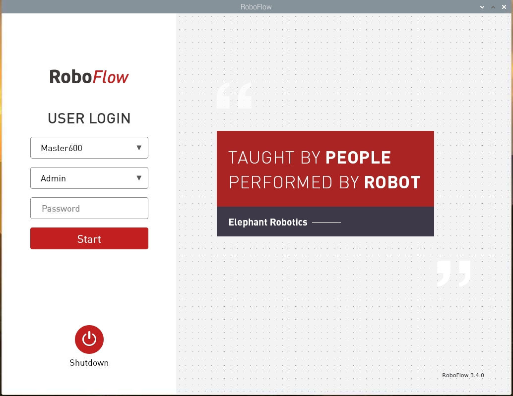</div>

#### 1.2 启动机器人

进入配置中心，点击启动机器人按钮

<div align=center>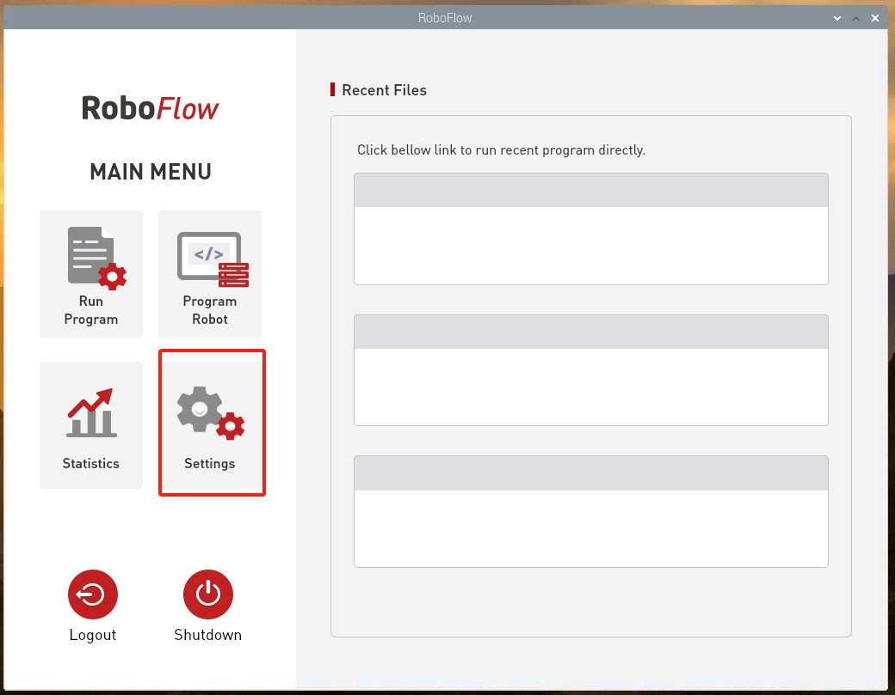</div>
<br>
<div align=center>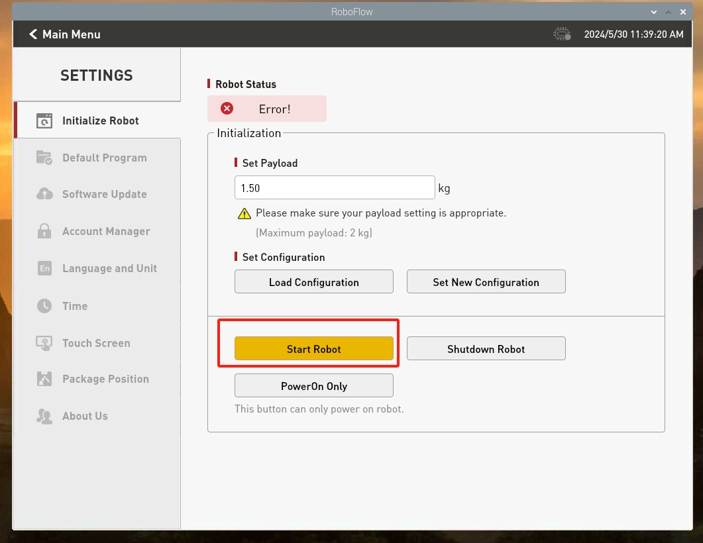</div>
<br>
<div align=center>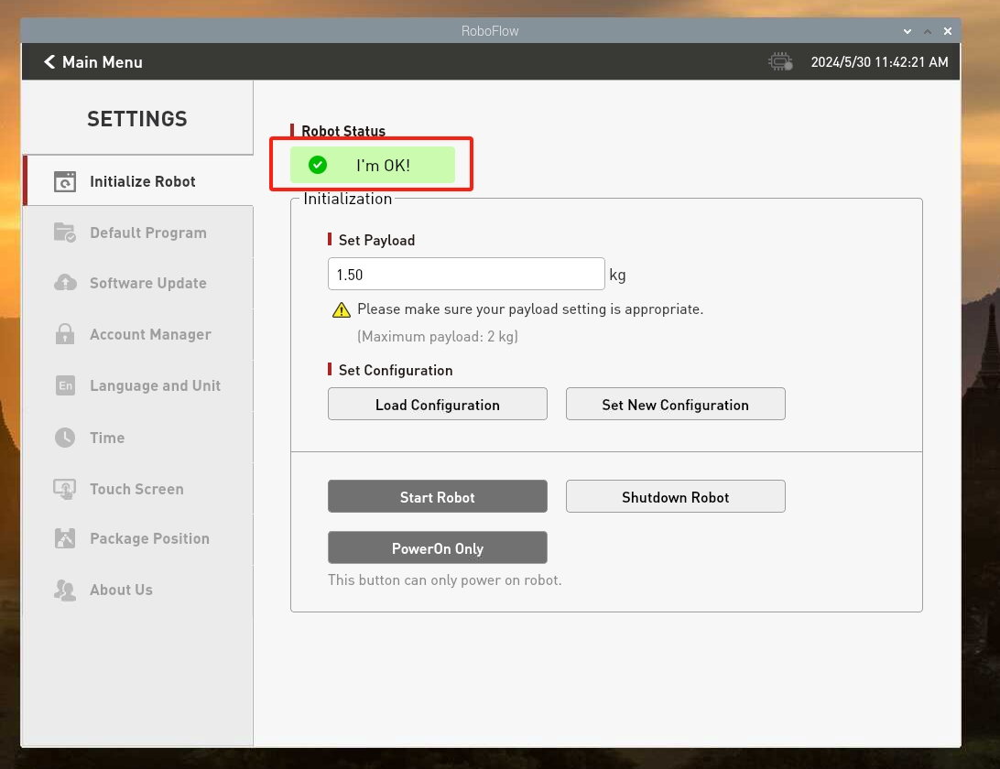</div>

#### 1.3 检查TCP服务器是否开启

返回主菜单，点击编写程序后，再点击空白程序，进入程序编辑界面后，点击配置按钮，点击网络/串口选项,检查TCP服务器是否开启，通常情况下，**TCP服务器是默认开启的**，若未开启，则需手动开启，也手动设置IP地址，如设置成**192.168.1.159**。

<div align=center>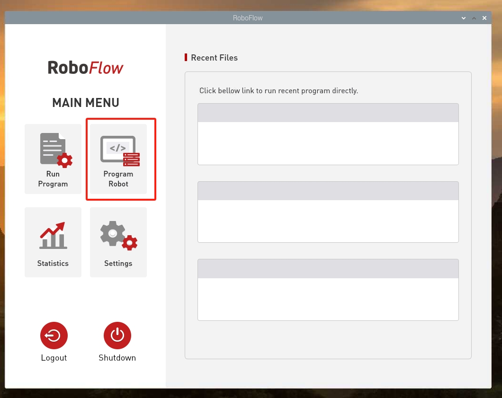</div>
<br>
<div align=center>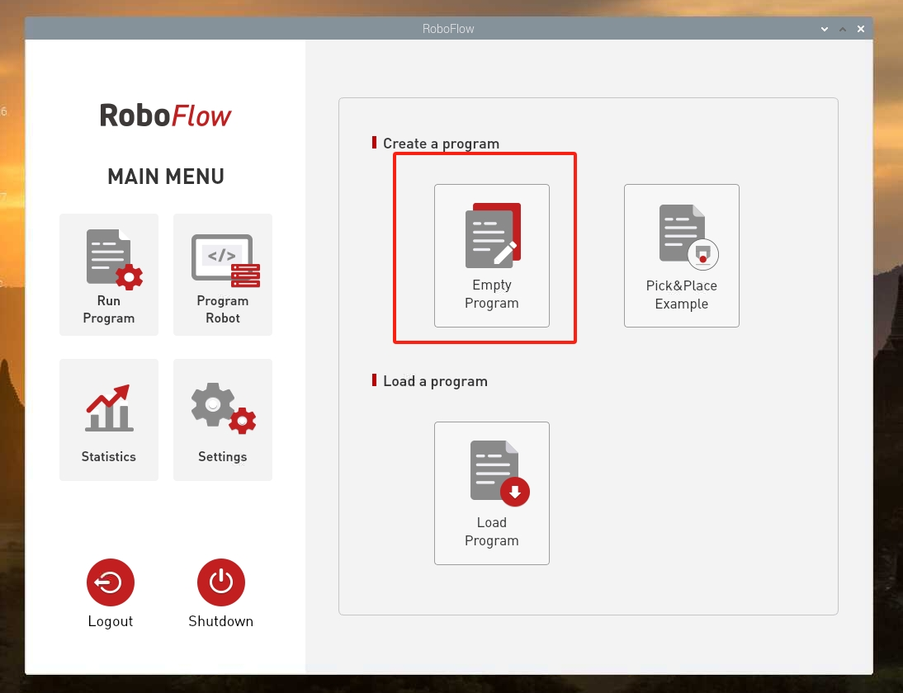</div>
<br>
<div align=center>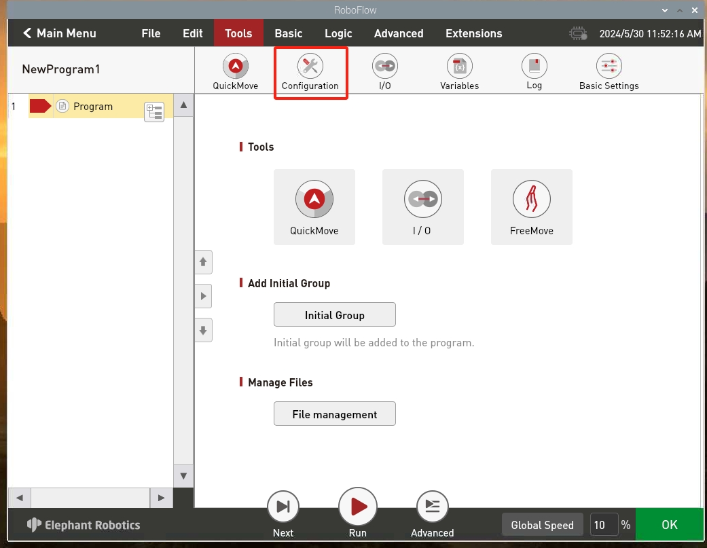</div>
<br>
<div align=center>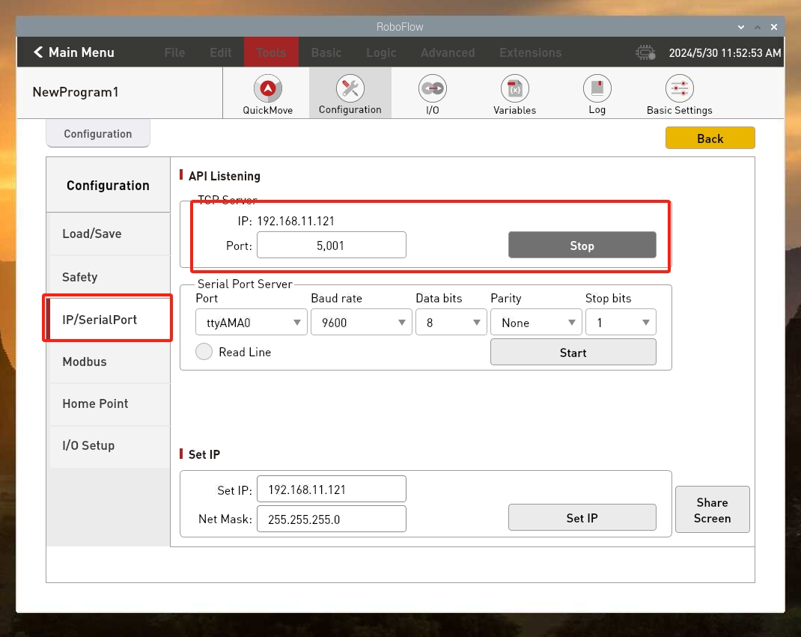</div>

### 2 环境准备

#### 2.1 有线网络通信准备

使用前需要确认有线网关正常才能跟机械臂正常通信，使用 `ip a` 查看有线网卡名称，然后调用：

```bash
# 确认 192.168.1.171 没有被其他电脑使用
sudo ip addr add 192.168.1.171/32 dev <替换成你的有线网卡名称>
sudo ip route replace 192.168.1.159/32 dev <替换成你的有线网卡名称> src 192.168.1.171
# 测试连接是否正常
ping -I <替换成你的有线网卡名称> 192.168.1.159
# 如果无法连接，则将 192.168.1.171 更换为其他 IP
```

#### 2.2 安装依赖与获取代码

使用该工程前，需要安装最新的 pymycobot Python API 库：

```bash
pip install pymycobot --user
```

创建工作空间并拉取代码：

```bash
mkdir -p ~/colcon_ws/src
cd ~/colcon_ws/src
git clone --branch Pro630gazebo https://github.com/elephantrobotics/mycobot_ros2.git
```

#### 2.3 编译与加载环境

编译并加载 ROS 2 环境：

```bash
cd ~/colcon_ws
source /opt/ros/humble/setup.bash
colcon build --packages-select mycobot_description mycobotpro630_gazeboros2
# 或全量编译
# colcon build
source install/setup.bash
```

### 3 公共环境

公共环境的操作效果如下：

<video id="pro630-gazebo-video-1" class="video-js" controls preload="auto" width="100%"
poster="" data-setup='{"aspectRatio":"16:9"}'>

  <source src=""></video>

#### 3.1 纯仿真与真机环境

如果机械臂选择末端装有myGripper F100 力控夹爪，则调用以下指令拉起公共环境：

```bash
# 纯仿真环境 带夹爪
ros2 launch mycobotpro630_gazeboros2 slider.launch.py environment:=simulation with_gripper:=true

# 真机环境 带夹爪
ros2 launch mycobotpro630_gazeboros2 slider.launch.py environment:=real with_gripper:=true
```

如果机械臂选择末端没有myGripper F100 力控夹爪，则调用以下指令拉起公共环境：

```bash
# 纯仿真环境 不带夹爪
ros2 launch mycobotpro630_gazeboros2 slider.launch.py environment:=simulation with_gripper:=false

# 真机环境 不带夹爪
ros2 launch mycobotpro630_gazeboros2 slider.launch.py environment:=real with_gripper:=false
```

- 启动成功后，会拉起 Gazebo 仿真环境，并实时跟踪真机机械臂姿态，期间可切换控制器来控制机械臂。
- 真机环境：启动时会读取一次真机姿态快照，并映射到 Gazebo 环境中。使用前需确认机械臂、末端、夹爪的固件版本为最新，并确保机械臂和夹爪通信正常。
- 纯仿真环境：默认从零位开始。

不带夹爪时，公共环境的运行效果如下：

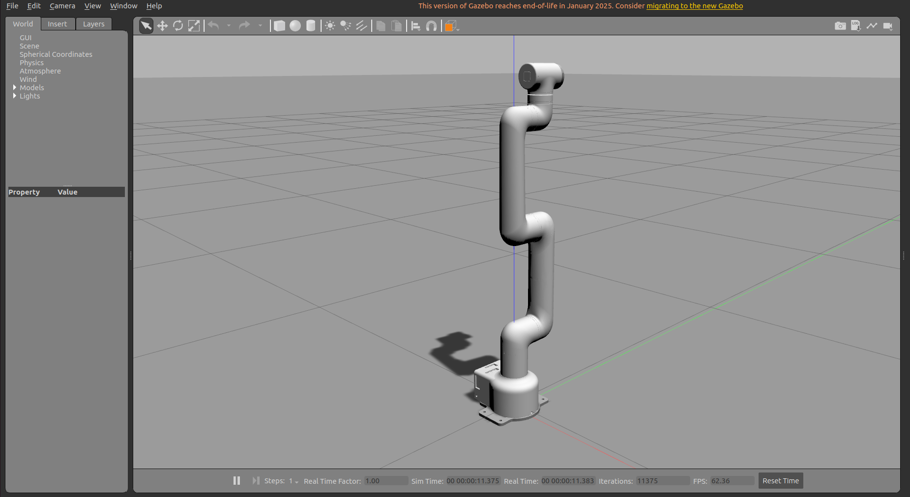

如果末端装有 myGripper F100 力控夹爪，则会看到以下界面：

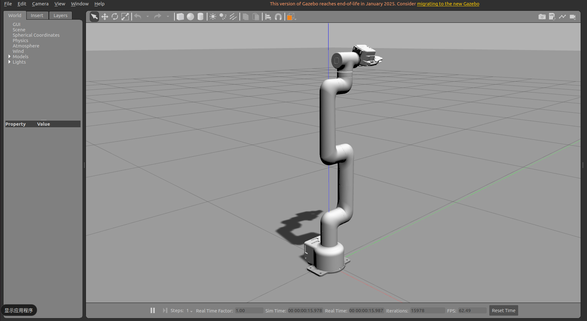

#### 3.2 特殊情况：机械臂本体低于水平面

如果坐标控制期间机械臂本体陷入水平面以下，则调用以下指令临时强制拉起公共环境：

```bash
# 真机环境 带夹爪
ros2 launch mycobotpro630_gazeboros2 slider.launch.py environment:=real with_gripper:=true allow_collision:=true

# 真机环境 不带夹爪
ros2 launch mycobotpro630_gazeboros2 slider.launch.py environment:=real with_gripper:=false allow_collision:=true
```

- 启动后的初始阶段，角度控制会被拒绝。需通过键盘控制、GUI 控制沿 Z 轴上移，或通过拖动跟随，使机械臂本体回到水平面以上，再改用正常指令重新拉起公共环境。
- `allow_collision:=true` 仅用于应急：坐标运动导致机械臂本体低于水平面的特殊情况。该参数默认为 `false`，且仅支持真机，即 `environment:=real`。
- 该模式仅临时用于坐标运动导致机械臂本体陷入水平面以下的特殊情况。脱离异常区域后，请切换回正常公共环境使用机械臂。
- 本工程的坐标运动仅限制末端不陷入水平面以下。具体见键盘控制的操作说明。

### 4 滑块与随机目标

滑块与随机目标的操作效果如下：

<video id="pro630-gazebo-video-2" class="video-js" controls preload="auto" width="100%"
poster="" data-setup='{"aspectRatio":"16:9"}'>

  <source src=""></video>

公共环境就绪后，另开终端：

```bash
ros2 launch mycobotpro630_gazeboros2 slider_control_gazebo.launch.py environment:=real
# 纯仿真时使用 environment:=simulation
```

- 启动成功后，会拉起用于`滑块和随机数操作`的 Qt 界面，界面和实际功能会自动适配公共环境是否有 myGripper F100 力控夹爪的情况。
- `Randomize Target` 按钮用于生成六轴与夹爪的随机角度。
- `Zero Target` 按钮用于生成机械臂的零位关节角度。
- 移动滑块、生成随机目标、回零生成关节角度后，均需点击 `Execute` 按钮，机械臂才会运动。
- `Stop` 按钮用于停止正在运动的机械臂。
- `environment` 参数需要与公共环境一致。检测到路径碰撞时，会显示 `Rejected: collision detected` 并拒绝执行。

不带夹爪时，滑块与随机目标的运行效果如下：

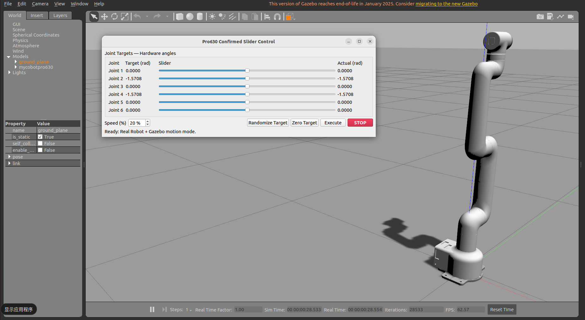

如果末端装有 myGripper F100 力控夹爪，则会看到以下界面：

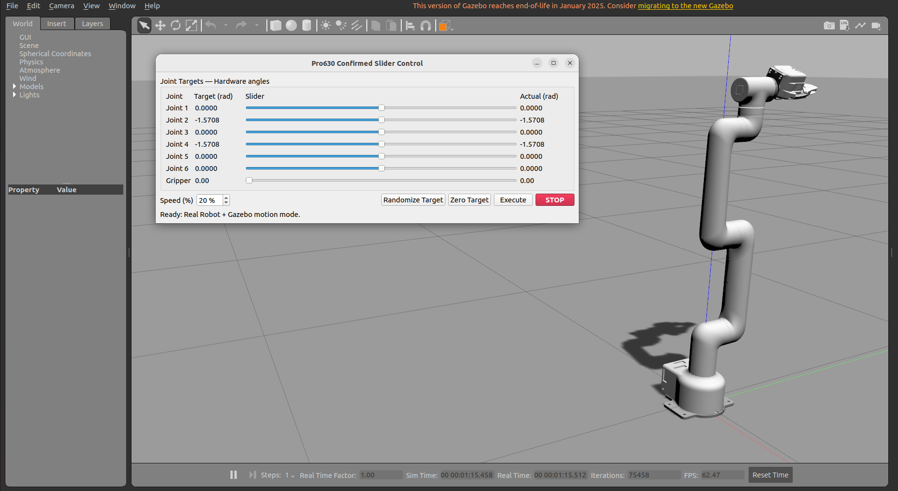

### 5 键盘控制

键盘控制的操作效果如下：

<video id="pro630-gazebo-video-3" class="video-js" controls preload="auto" width="100%"
poster="" data-setup='{"aspectRatio":"16:9"}'>

  <source src=""></video>

公共环境就绪后，另开终端：

```bash
ros2 launch mycobotpro630_gazeboros2 teleop_keyboard.launch.py
```

- 启动成功后，会拉起用于`键盘控制`的 Qt 界面，界面和实际功能会自动适配公共环境是否有 myGripper F100 力控夹爪的情况。
- 装有 myGripper F100 力控夹爪时，机械臂反馈的坐标信息会延伸到夹爪末端，但进行坐标运动的末端参考依然是link6末端。

仅支持真机。

聚焦窗口后：

- `M`：解锁控制
- `N` 或 `Space`：停止并锁定
- `C`：清除奇异位姿导致的报错
- `Q`：关闭窗口并退出
- 按住 `w` / `s`、`a` / `d`、`z` / `x` 分别控制位置 X、Y、Z；按住 `u` / `j`、`i` / `k`、`o` / `l` 分别控制姿态角 RX、RY、RZ
- 按住 `g` / `h` 控制夹爪开合，未安装夹爪时无此功能
- `1`：回到机械臂零位
- `2`：回到坐标控制 Home 位
- `3`：自定义坐标控制 Home 位，将当前位置设置为坐标运动 Home 位，下次启动键盘控制时需重新设置
- 松开按键即停止，窗口失焦即停止
- 108 键布局下，主键盘区的 `-`（`_`）、`+`（`=`），以及小键盘区的 `-` / `+`，均可切换速度档位
- 键盘控制进入奇异位姿时将无法继续控制，需按 `2` 回到坐标控制 Home 位方可重新使用键盘控制。
- 控制期间不允许运动到水平面以下。末端距地面 20 mm 时会触发保护机制，需先长按 `X` 向上运动并脱离触发区域，才能继续其他运动按键；此时仍可调整速度档位。
- 本工程的保护机制仅限制末端，不能保证机械臂本体不与地面碰撞，操作时需谨慎。
- 按键控制不区分大小写。
- 界面持续显示可操作按键、当前设定速度、速度档位、当前有效按键、提示信息等。
- 630 进入奇异位置时，不会改变 LED 屏颜色。如果机械臂静止但六轴坐标跳变，或调用坐标运动时打印 `The current pose is singular. Please use joint control to move away`，即当前为奇异姿态，需要用角度运动脱离。可以参考[奇异姿态典例](https://docs.elephantrobotics.com/docs/pro630-cn/2-ProductFeature/2.5-CoordinateSystem.html)

坐标运动导致关节超限时：

- 此时机械臂的关节角度运动和坐标运动均会失效。请进入机械臂桌面，使用 RoboFlow 通过关节角度运动脱离超限位置，再回到本工程继续使用机械臂。具体操作可参考 [RoboFlow 使用](https://docs.elephantrobotics.com/docs/pro630-cn/5-BasicApplication/5.2-ApplicationUse.html#13%E5%BF%AB%E9%80%9F%E7%A7%BB%E5%8A%A8) 中的 1.2 新建工程和 1.3 快速移动章节。

不带夹爪时，键盘控制的运行效果如下：

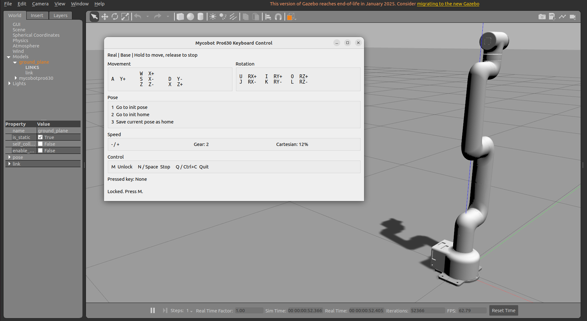

如果末端装有 myGripper F100 力控夹爪，则会看到以下界面：

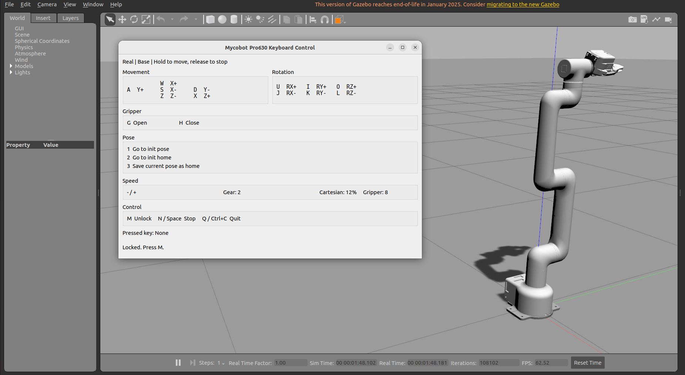

### 6 拖动跟随

拖动跟随的操作效果如下：

<video id="pro630-gazebo-video-4" class="video-js" controls preload="auto" width="100%"
poster="" data-setup='{"aspectRatio":"16:9"}'>

  <source src=""></video>

公共环境就绪后，另开终端：

```bash
ros2 launch mycobotpro630_gazeboros2 drag_follow_gazebo.launch.py
```

仅支持真机。

- 启动成功后，会拉起用于`拖动跟随`的 Qt 界面，界面和实际功能会自动适配公共环境是否有 myGripper F100 力控夹爪的情况。
- `M`：控制机械臂进入自由拖动模式。进入后机械臂 link5 的 LED 屏变为黄色，此时按下 LED 屏并听到两声咔咔声即可开始自由拖动；松开 LED 屏后机械臂锁紧，但不会退出自由拖动模式。再次按下 `M` 退出自由拖动模式，锁紧六轴和夹爪。
- `Q`：关闭窗口退出。
- 退出拖动跟随界面前，请将机械臂运动到零位附近，并确认关节未超限。程序退出时会自动清错并退出自由拖动模式。

不带夹爪时，拖动跟随的运行效果如下：

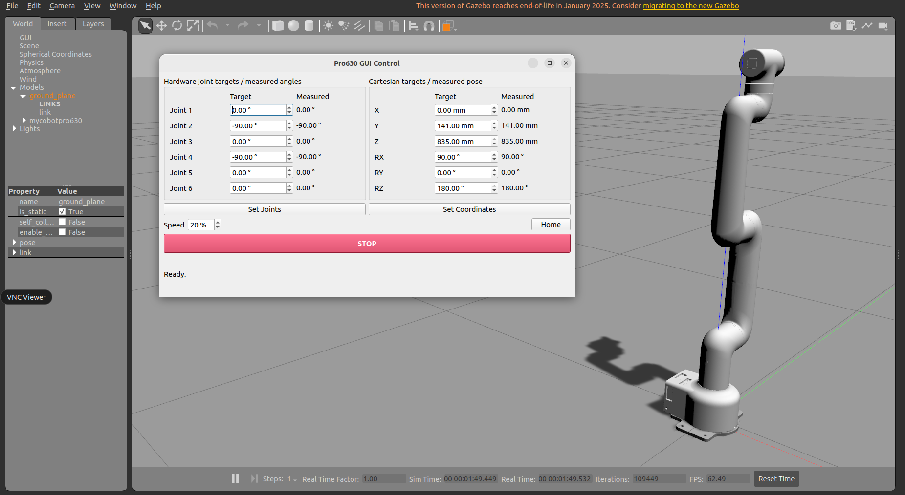

如果末端装有 myGripper F100 力控夹爪，则会看到以下界面：

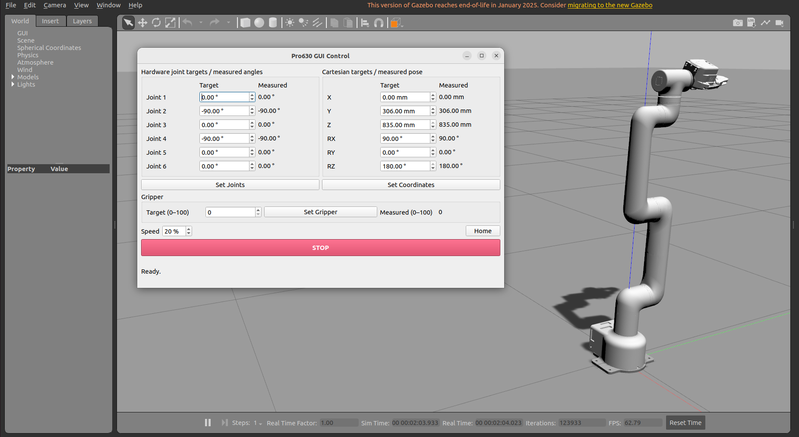

### 7 GUI 控制

GUI 控制的操作效果如下：

<video id="pro630-gazebo-video-5" class="video-js" controls preload="auto" width="100%"
poster="" data-setup='{"aspectRatio":"16:9"}'>

  <source src=""></video>

公共环境就绪后，另开终端：

```bash
ros2 launch mycobotpro630_gazeboros2 gui_control_gazebo.launch.py
```

仅支持真机。

- 启动成功后，会拉起用于 `GUI 控制` 的 Qt 界面，界面和实际功能会自动适配公共环境是否有 myGripper F100 力控夹爪。
- 装有 myGripper F100 力控夹爪时，该控制器进行坐标运动的末端会自动延伸至夹爪末端。
- 坐标控制需先点击 `Home`，进入坐标控制 Home 位后再开始坐标运动。该按钮也可用于脱离奇异位姿。
- 输入速度、目标角度或坐标后，点击 `Set Gripper`、`Set Joints` 或 `Set Coordinates`，执行相应运动。
- `Stop` 按钮用于停止正在运动的机械臂。
- 角度运动的路径检测到碰撞时，会显示 `Rejected: collision detected` 并拒绝执行。
- 若当前位姿为奇异位姿，在 Qt 界面中调用坐标控制或角度控制时，会提示 `The current pose may be singular. Please use joint control to move away.`。此时无法进行坐标运动，需点击 `Home` 回到坐标控制 Home 位方可恢复运动。

- 630 进入奇异位置时，不会改变 LED 屏颜色。如果机械臂静止但六轴坐标跳变，或调用坐标运动时打印 `The current pose is singular. Please use joint control to move away`，即当前为奇异姿态，需要用角度运动脱离。可以参考[奇异姿态典例](https://docs.elephantrobotics.com/docs/pro630-cn/2-ProductFeature/2.5-CoordinateSystem.html)

坐标运动导致关节超限时：

- 此时机械臂的关节角度运动和坐标运动均会失效。请进入机械臂桌面，使用 RoboFlow 通过关节角度运动脱离超限位置，再回到本工程继续使用机械臂。具体操作可参考 [RoboFlow 使用](https://docs.elephantrobotics.com/docs/pro630-cn/5-BasicApplication/5.2-ApplicationUse.html#13%E5%BF%AB%E9%80%9F%E7%A7%BB%E5%8A%A8) 中的 1.2 新建工程和 1.3 快速移动章节。

不带夹爪时，GUI 控制的运行效果如下：

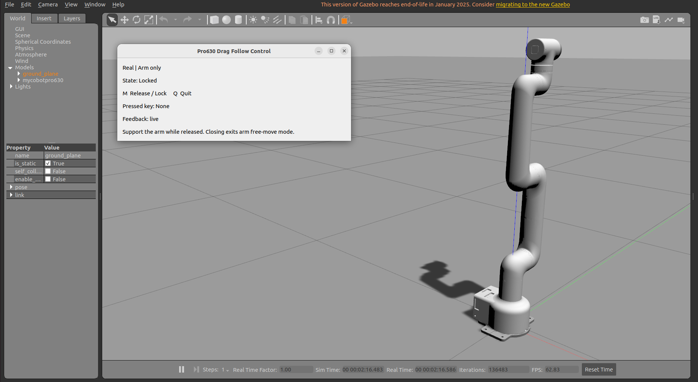

如果末端装有 myGripper F100 力控夹爪，则会看到以下界面：

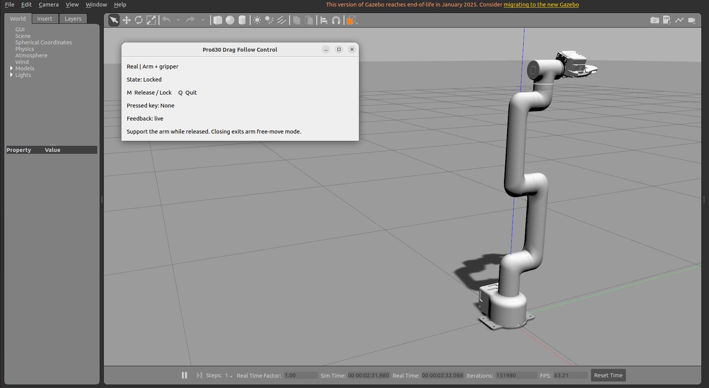

---

[← 上一页](11.2.4-RViz2_Control.md) | [下一节 →](../../7-ExamplesRobotsUsing/7-ExamplesRobotsUsing.md)
